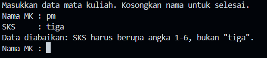

# Tugas Rutin 3 - Kalkulator IP Semester

## Identitas
- Nama: M. FARIS AL RAFIQ
- NIM: 4241250001
- Kelas: PSIK24C

## Tangkapan Layar

## Penjelasan
Higher-order function saya gunakan pada beberapa bagian program. Di hitungIp, fold berfungsi menjumlahkan seluruh SKS dan poin nilai (SKS x bobot) sebagai dasar perhitungan IP. Pada cetakKhs, where digunakan untuk memilih mata kuliah dengan bobot di bawah 2, kemudian map mengambil nama mata kuliah tersebut. Selanjutnya, sort dengan fungsi pembanding mengurutkan KHS berdasarkan nilai tertinggi. Fungsi pembanding tersebut merupakan fungsi anonim yang diberikan sebagai argumen.

Untuk menangani error, fungsi validasiSks dan validasiNilai melempar FormatException apabila SKS yang dimasukkan bukan angka 1-6 atau nilai yang dimasukkan bukan A-E. Exception tersebut kemudian ditangkap di main menggunakan try/on FormatException. Dengan cara ini, data yang salah akan dilewati dan program tetap berjalan. Jadi, fungsi validasi cukup bertugas memeriksa data, sedangkan pesan untuk pengguna ditangani di satu tempat.

## Penggunaan AI
Saya memakai Claude untuk membantu menyusun kerangka kode dan README. Saya
menjalankan, menguji, dan memahami kodenya sendiri.